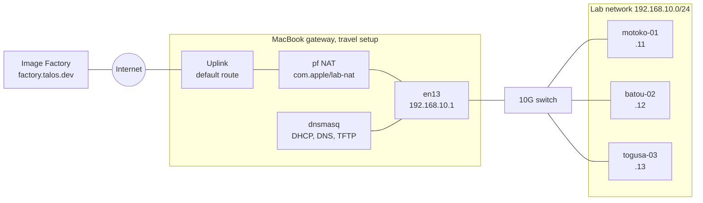
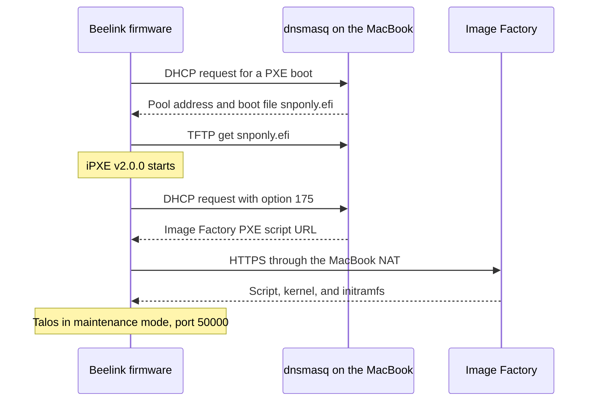
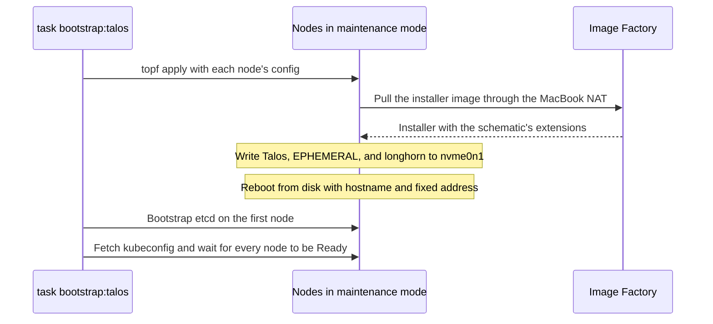

# home-ops

A 3-node Talos Kubernetes lab on Beelink SER9 Pro mini PCs. `AGENTS.md` has the address plan and the rules. `docs/hardware.md` records each unit.

Do the steps in order. Talos boots over the network from the lab gateway.

Every change to the MacBook or the nodes runs through `task`. Run `task` to list the commands. They need `task`, `talosctl`, `topf`, `sops`, and `kubectl`. Install TOPF with `brew install postfinance/tap/topf`. The Talos secrets are SOPS-encrypted in the repo and decrypt with the age key at `~/.config/sops/age/home-ops.txt`.

## How the lab fits together

This is the travel setup, with the MacBook as the gateway.



## 1. Start the lab network

1. Connect the USB Ethernet adapter to the lab switch. It shows up as `en13`.
2. Run `task lab:up`. It runs `scripts/lab-net-up.sh` with `sudo` and shares whichever MacBook connection holds the default route. You can rerun it safely.
3. Check the result with `ifconfig en13`, `pgrep -lf dnsmasq`, and `sudo pfctl -a com.apple/lab-nat -s nat`.

To undo everything, run `task lab:down`. After a MacBook reboot, run `task lab:up` again.

dnsmasq writes leases to `/opt/homebrew/var/lib/misc/dnsmasq/dnsmasq.leases`.

## 2. Set the BIOS for Talos

Power on and press `Del`. All three units came with BIOS SER9L104, shown on the **Main** page. The defaults work for Talos. Change these two settings, then press `F4` to save.

| Setting | Where | Value |
| --- | --- | --- |
| AC power loss | Advanced → AMD CBS → FCH Common Options → Ac Power Loss Options | Always on |
| iGPU memory | Advanced → AMD CBS → NBIO Common Options → GFX Configuration | `UMA_SPECIFIED`, 512M |

## 3. Boot Talos over the network

dnsmasq answers a network-booting unit with the iPXE program over TFTP. iPXE then loads the Talos image in `talos/README.md` from Image Factory over HTTPS. `scripts/lab-net-up.sh` downloads the iPXE version pinned in `scripts/lab-net.env`.



1. Start the lab network.
2. Power on a unit, press `F7`, and pick the PXE IPv4 entry for the Ethernet port.
3. Talos starts in maintenance mode, takes an address from the DHCP pool, and shows it on the console.
4. Find each node's address on its console or in the dnsmasq leases file.
5. Read each node's details:

   ```bash
   talosctl version --insecure -n <ip>
   talosctl get links --insecure -n <ip>
   talosctl get disks --insecure -n <ip>
   ```

6. Record the NIC name and driver, MAC, link speed, and disks in `docs/hardware.md`.
7. Uncomment the node's `dhcp-host` line in `network/dnsmasq.conf` and fill in its MAC.
8. Run `task lab:up` again. Power-cycle each node and network boot it again from `F7`, so it takes its reserved address.

The maintenance API has no authentication. Keep the nodes on the lab network until the cluster config is applied.

## 4. Install Talos and bootstrap the cluster

[TOPF](https://postfinance.github.io/topf/) builds each node's config from the node list in `talos/topf.yaml`, the patches in `talos/all/` and `talos/control-plane/`, and the secrets in `talos/secrets.sops.yaml`. A patch in `talos/node/<host>/` applies to one node only. On the 1 TB disk, Talos keeps 200 GiB for itself, and the `longhorn` volume at `/var/mnt/longhorn` takes the rest.



1. Add each node to `talos/topf.yaml` with its reserved address. TOPF reaches a node in maintenance mode at that address, so the node must have taken its reservation in section 3.
2. Run `task talos:genconfig` to render and validate every node's config.
3. Once all three nodes are listed, run `task bootstrap:talos`. It installs each node still in maintenance mode, which erases its disk. Then it bootstraps etcd, writes the talosconfig and kubeconfig to `~/.talos/home-ops`, and waits for every node to be `Ready`.

After the bootstrap, `task talos:apply` rolls out a config change. It shows the diff and asks before applying. `task talos:kubeconfig` writes a fresh 12-hour admin kubeconfig.

To run `talosctl` or `kubectl` yourself, export `TALOSCONFIG=~/.talos/home-ops/talosconfig` and `KUBECONFIG=~/.talos/home-ops/kubeconfig`.
